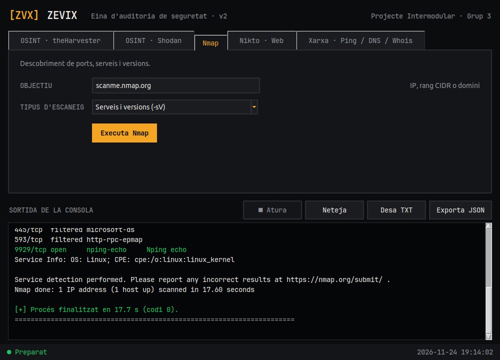
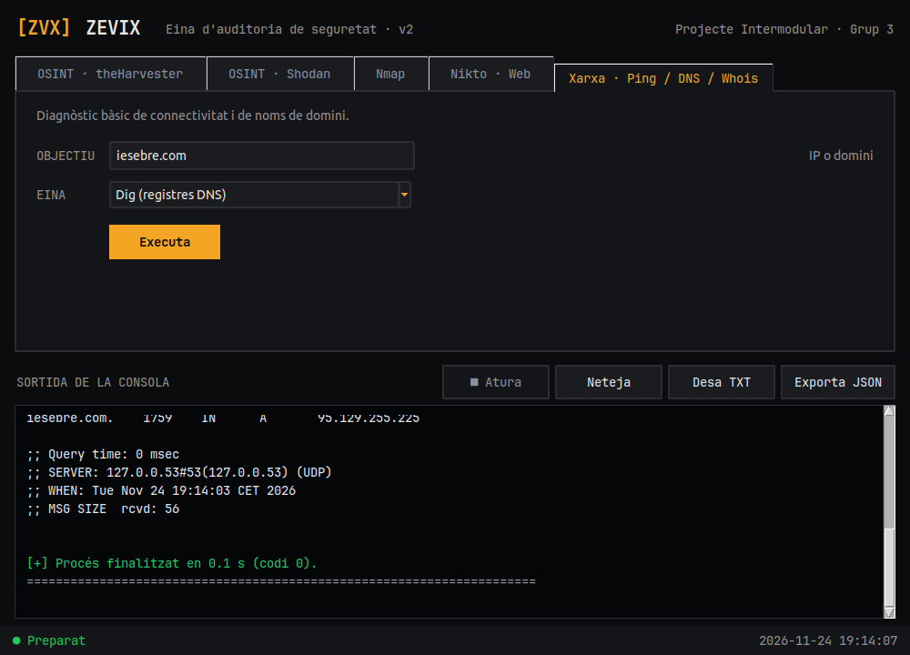

# Eina d'auditoria · Zevix Cybersecurity (v2.1)

Aplicació d'escriptori en Python (tkinter) que reuneix les eines d'auditoria del projecte en una sola interfície.

| Fitxer | Descripció |
|---|---|
| `zevix_audit.py` | Aplicació gràfica amb les pestanyes OSINT (theHarvester i Shodan), Nmap, Nikto i Xarxa (ping, dig i whois) |
| `shodan_audit.py` | Versió de terminal del mòdul de Shodan (menú) |

## Novetat v2.1: de l'eina al portal de clients

1. Executa els escanejos (Nmap i/o Nikto) des de l'eina.
2. A la pestanya **Informe**, omple el client, el contracte i l'abast i prem **Genera informe**. L'eina analitza la sortida amb una **base de regles de riscos** (`REGLES_PORTS`: què vol dir cada port obert, amb gravetat, CVSS orientatiu i recomanació, segons la nostra anàlisi de riscos) i desa l'informe en JSON (el format que llegeix la web) i en HTML.
3. A la web, entra com a administrador, ves a **Pujar informe** i tria el JSON.
4. Entra com a client (o prem *Accedir com a client*): el portal mostra les troballes, la distribució del risc i el pla de millora d'aquest informe.

Exemple real: [informes_auditoria/exemple_eina_scanme.json](../informes_auditoria/exemple_eina_scanme.json) (escaneig `nmap -sV` de scanme.nmap.org).

## Requisits

```bash
sudo apt install python3-tk nmap nikto dnsutils whois theharvester python3-shodan
```

La clau de Shodan es llegeix d'una **variable d'entorn**, mai del codi:

```bash
export SHODAN_API_KEY="la_vostra_clau"
python3 zevix_audit.py
```

## Captures

| Nmap (`-sV` a scanme.nmap.org) | Xarxa (`dig` de iesebre.com) |
|---|---|
|  |  |

## Canvis respecte a la v1

| Àmbit | v1 | v2 |
|---|---|---|
| **Clau de Shodan** | Escrita dins de `shodan_audit.py` | Variable d'entorn `SHODAN_API_KEY`. Corregeix el risc nº 9 de la nostra anàlisi de riscos |
| **Shodan** | Script de terminal separat | Pestanya "OSINT · Shodan" dins de l'aplicació (consulta d'IP i cerca global) |
| **Domini d'exemple** | `iesebre.cat` (no existeix) | `iesebre.com` |
| **Disseny** | Tema clam per defecte | Tema fosc amb la imatge de Zevix (accent ambre, tipografia monoespaiada), capçalera, barra d'estat amb rellotge i temps d'execució |
| **Consola** | Text verd sense distinció | Colors per tipus de línia: ordres (ambre), ports oberts (verd), avisos (groc) i errors (vermell) |
| **Validació** | Només comprovava que el camp no fos buit | Comprova IP, rang CIDR, domini, URL, port (1-65535) i nom de fitxer abans d'executar |
| **Fils i interfície** | El fil secundari escrivia directament a la finestra | El fil envia les línies a una cua (`queue`) i la finestra les llegeix amb `root.after`: tkinter només s'ha de modificar des del fil principal |
| **Control** | No es podia aturar un escaneig | Botó "Atura" (`process.terminate()`) i botons desactivats mentre hi ha una eina en marxa |
| **Resultats** | Només a la pantalla | "Desa TXT" i "Exporta JSON" amb l'historial d'execucions (eina, ordre, data, durada, codi de sortida i sortida) |
| **Eines no instal·lades** | Missatge genèric | Indica el paquet que cal instal·lar; theHarvester es busca amb els dos noms habituals (`theHarvester` i `theharvester`) |

## Com funciona (per explicar-ho a la presentació)

1. Cada pestanya té un formulari. En prémer el botó, es **validen** les dades amb expressions regulars (`es_ip`, `es_domini`, `es_objectiu`).
2. `binari()` comprova amb `shutil.which` que l'eina estigui instal·lada.
3. `inicia()` neteja la consola, desactiva els botons i llança un **fil** (`threading.Thread`) que executa l'ordre amb `subprocess.Popen`.
4. El fil llegeix la sortida línia a línia i la posa a una **cua**. Cada 100 ms, `processa_cua()` (al fil principal) treu les línies de la cua, les pinta amb el color que toca i les guarda a l'historial.
5. Quan el procés acaba, s'envia el missatge `fi` amb el codi de sortida: es mostra el temps, es guarda l'execució a l'historial i es tornen a activar els botons.
6. Shodan fa servir la llibreria `shodan` en lloc d'un programa extern, però segueix el mateix camí (fil → cua → consola).

## Limitacions conegudes

- `nmap -A` (detecció de sistema operatiu) necessita privilegis de root. Sense `sudo`, Nmap fa la resta de l'escaneig però avisa que no pot detectar el sistema operatiu.
- Les pestanyes de theHarvester, Nikto i Shodan només s'han provat sense l'eina instal·lada o sense clau (mostren el missatge d'error que toca). Cal provar-les en un equip amb tot instal·lat abans de la presentació.
- L'informe pujat al portal es guarda al navegador (localStorage): és un prototip. Amb un backend (Django) es desaria al servidor i el veuria qualsevol client des de qualsevol equip.
- La base de regles només té en compte els ports oberts de Nmap i les troballes de Nikto; encara no analitza les versions per buscar CVE.

> Auditeu només sistemes inclosos a l'abast del contracte. Per fer proves sense permís de ningú es pot fer servir `scanme.nmap.org`, el servidor que el projecte Nmap ofereix per a això.
