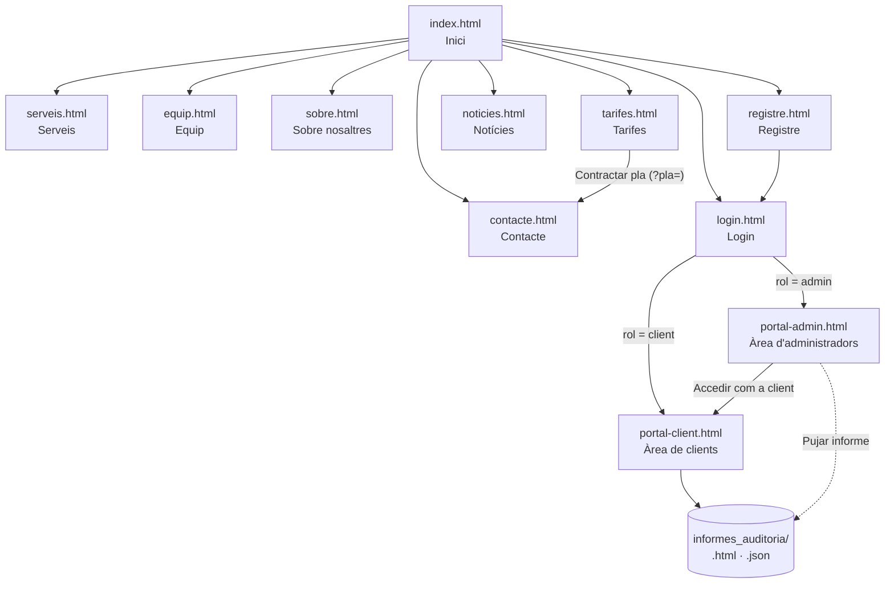

# Documentació de la Landing Page — Zevix Cybersecurity

**Projecte Intermodular (MP0379) · CFGS ASIX Ciberseguretat · Institut de l'Ebre · Curs 2026-27**
**Grup 3:** Pau Serra Bertomeu · Iker Espinosa López · Maria del Valle Suñe Nieto
**Sprint 1** — Lliurament màxim: 30/11/2026

---

## Índex

1. [Descripció](#1-descripció)
2. [Tecnologies utilitzades](#2-tecnologies-utilitzades)
3. [Sitemap](#3-sitemap)
4. [Mockup](#4-mockup)
5. [Descripció dels fitxers principals](#5-descripció-dels-fitxers-principals)
6. [Explicació de les principals decisions preses](#6-explicació-de-les-principals-decisions-preses)
7. [Desplegament](#7-desplegament)
8. [Transició cap a la plataforma](#8-transició-cap-a-la-plataforma)

---

## 1. Descripció

La landing page és la carta de presentació de **Zevix Cybersecurity**, l'empresa d'auditories de seguretat informàtica creada pel Grup 3. Té dos objectius:

- **Comercial:** captar l'interès de possibles clients (pimes), explicar els serveis, mostrar l'equip, els plans de preus i facilitar el contacte.
- **Funcional:** ser la porta d'entrada a la **plataforma** on els clients consulten i descarreguen els informes d'auditoria i on l'equip Zevix gestiona clients i informes.

Flux d'usuari: **Usuari → Landing Page → Login → Plataforma (Àrea de clients / Àrea d'administradors) → Resultats de l'auditoria.**

Pàgines que inclou:

| Pàgina | Contingut |
|---|---|
| Inici | Navbar (logo, menú, botons *Accedir* i *Registrar-se*), hero amb proposta de valor, resum de serveis, metodologia, avantatges, crida a l'acció i footer amb logos de clients i xarxes socials |
| Serveis | Detall de cada servei (OSINT, escaneig de ports, SSH, SMB, web/DNS/FTP, pla de millora): en què consisteix i per què és important |
| Equip | Membres, càrrec, estudis, descripció i gustos, amb fotografia |
| Sobre nosaltres | Història, finalitat de l'empresa, missió/visió/valors i estàndards |
| Tarifes | 3 plans — **Bàsic (senzill)**, **Professional (mitjà)** i **Avançat (fort)** —, comparativa i FAQ |
| Notícies | Blog d'articles de ciberseguretat amb filtre per categories |
| Contacte | Formulari amb validació, dades de contacte, xarxes socials i mapa |
| Login / Registre | Accés per rols (client / administrador) i alta de nous clients |
| Portal client | Resum de riscos, llistat de vulnerabilitats, pla de millora i **descàrrega d'informes** |
| Portal admin | Gestió de clients, estat dels mòduls de l'eina, pujada d'informes, registre d'activitat i opció d'**accedir com a client** |

## 2. Tecnologies utilitzades

| Tecnologia | Ús al projecte |
|---|---|
| **HTML5** | Estructura semàntica (`header`, `nav`, `main`, `section`, `article`, `footer`), formularis amb atributs d'accessibilitat |
| **CSS3** | Disseny responsive amb **CSS Grid** i **Flexbox**, variables CSS (`:root`) per als colors corporatius, animacions i *media queries* (mòbil, tauleta, escriptori) |
| **JavaScript (ES6)** | Manipulació del DOM, validació de formularis, menú mòbil, animacions en fer scroll (`IntersectionObserver`), lectura de l'informe JSON amb `fetch()` i mòdul d'autenticació per rols |
| **SVG** | Logotip i icones vectorials (sense dependències externes) |
| **Google Fonts** | Tipografies *Inter* (text) i *JetBrains Mono* (detalls tècnics) |
| **Git + GitHub** | Control de versions i treball col·laboratiu |
| **GitHub Pages** | Allotjament i desplegament amb HTTPS |
| **Python (script de generació)** | No es publica; les pàgines comparteixen capçalera i peu i s'han mantingut coherents |

No s'utilitza cap framework ni llibreria JavaScript externa: la web és lleugera, ràpida i fàcil d'auditar.

## 3. Sitemap



Nivells:

- **Nivell 1 — Zona pública:** Inici, Serveis, Equip, Sobre, Tarifes, Notícies, Contacte.
- **Nivell 2 — Passarel·la d'autenticació:** Login i Registre.
- **Nivell 3 — Zona privada:** Portal de clients i Portal d'administradors (protegits per rol).

## 4. Mockup

Abans de programar es va fer el següent esquema (wireframe) de la pàgina d'inici i del login. Paleta: fons fosc `#070b14`, cian `#22d3ee` i blau `#3b82f6`, per transmetre tecnologia i confiança.

```
┌──────────────────────────────────────────────────────────────────────┐
│ [LOGO] ZEVIX   Inici Serveis Equip Sobre Tarifes Notícies Contacte  [Accedir][Registrar-se] │
├──────────────────────────────────────────────────────────────────────┤
│  ● Auditories de seguretat per a pimes      ┌──────────────────────┐ │
│  Trobem les teves vulnerabilitats           │ ● ● ●  terminal      │ │
│  abans que ho faci un atacant.              │ $ docker run zevix.. │ │
│  [Sol·licitar auditoria] [Veure serveis]    │ [!] CRÍTIC root SSH  │ │
│  7 mòduls · 48h informe · 100% confidencial └──────────────────────┘ │
├──────────────────────────────────────────────────────────────────────┤
│  QUÈ FEM:  [OSINT] [Ports] [SSH] [SMB] [Web/DNS] [Pla de millora]    │
├──────────────────────────────────────────────────────────────────────┤
│  COM TREBALLEM: 01 Contracte → 02 Escaneig → 03 Riscos → 04 Informe  │
├──────────────────────────────────────────────────────────────────────┤
│  PER QUÈ ZEVIX: [Docker] [Telegram] [Confidencial] [Portal clients]  │
├──────────────────────────────────────────────────────────────────────┤
│  CTA: Saps quantes portes té obertes la teva xarxa? [Veure tarifes]  │
├──────────────────────────────────────────────────────────────────────┤
│  Empreses que confien: EbreLogistics · DeltaAgro · Clínica Montsià…  │
│  FOOTER: logo + xarxes socials | Empresa | Serveis | Butlletí        │
└──────────────────────────────────────────────────────────────────────┘

LOGIN
┌───────────────────────────┬──────────────────────────┐
│ Accés a la plataforma     │  Iniciar sessió          │
│ ◆ Resum de riscos         │  [ Client | Administrador ]│
│ ◆ Descàrrega d'informes   │  Correu    [__________]  │
│ ◆ Pla de millora          │  Contrasenya [________]  │
│                           │  [        Entrar       ] │
└───────────────────────────┴──────────────────────────┘
```

> Es pot substituir aquest esquema per una captura del mockup fet amb Figma / Penpot si l'equip el prepara (desar-lo a `docs/img/mockup.png`).

## 5. Descripció dels fitxers principals

```
PROJECTE-INTERMODULAR/
├── index.html               Pàgina d'inici (landing)
├── serveis.html             Detall dels serveis
├── equip.html               Presentació de l'equip
├── sobre.html               Història i valors de l'empresa
├── tarifes.html             Plans Bàsic / Professional / Avançat
├── noticies.html            Blog de ciberseguretat
├── contacte.html            Formulari de contacte
├── login.html               Inici de sessió per rols
├── registre.html            Alta de nous clients
├── portal-client.html       Àrea privada de clients
├── portal-admin.html        Àrea privada d'administradors
├── assets/
│   ├── css/style.css        Full d'estils únic (variables, components, responsive)
│   ├── js/main.js           Lògica comuna: menú, animacions, formularis, tarifes, blog
│   ├── js/auth.js           Mòdul d'autenticació i control d'accés per rols (prototip)
│   └── img/                 Logo, favicon i fotos de l'equip (img/equip/*.jpg)
├── informes_auditoria/      Informes d'exemple que genera l'eina Python (.json / .html)
├── docs/                    Documentació del projecte
├── .nojekyll                Indica a GitHub Pages que serveixi els fitxers tal qual
└── README.md                Portada del repositori
```

| Fitxer | Responsabilitat |
|---|---|
| `assets/css/style.css` | Tot el disseny. Els colors es defineixen com a variables a `:root`, de manera que canviar la imatge corporativa només requereix editar unes línies. |
| `assets/js/main.js` | Comportament de la web pública: menú hamburguesa, animacions `reveal`, terminal animada, commutador mensual/anual de tarifes, filtre del blog i validació del formulari de contacte (`validateForm`). |
| `assets/js/auth.js` | Objecte `ZevixAuth` amb `login()`, `register()`, `logout()`, `currentUser()` i `require(roles)`. Guarda la sessió a `sessionStorage` i protegeix les pàgines privades redirigint al login si no hi ha sessió o el rol no és vàlid. |
| `portal-client.html` | Llegeix `informes_auditoria/informe_ebrelogistics_2026.json` amb `fetch()` i genera dinàmicament els comptadors per gravetat, la barra de risc, la taula de vulnerabilitats i el pla de millora. Permet descarregar l'informe en HTML i JSON. |
| `portal-admin.html` | Només accessible amb rol `admin`. Llista de clients, estat dels mòduls de l'eina, formulari de pujada d'informes (simulat) i registre d'activitat. |
| `informes_auditoria/*.json` | Format d'informe que exportarà l'eina d'auditoria en Python. És el "contracte" de dades entre l'eina i la plataforma web. |

## 6. Explicació de les principals decisions preses

### 6.1 Disseny
- **Tema fosc amb blau i cian:** estètica habitual al sector de la ciberseguretat que transmet tecnologia i professionalitat.
- **Terminal animada al hero:** mostra de manera visual què fa la nostra eina, en lloc de només explicar-ho.
- **Mobile-first i responsive:** tota la web s'adapta a mòbil, tauleta i escriptori.
- **Accessibilitat:** etiquetes `label` als formularis, `aria-label` a les icones, contrast alt i respecte a `prefers-reduced-motion`.
- **Plans de preus en 3 nivells** (senzill, mitjà, fort), tal com indica l'enunciat, amb el pla mitjà destacat com a "més popular".

### 6.2 Justificació de tecnologies

| Opció | Avantatges | Inconvenients | Decisió |
|---|---|---|---|
| **HTML + CSS + JS estàtic** | Gratuït a GitHub Pages, HTTPS automàtic, molt ràpid, superfície d'atac mínima (no hi ha servidor ni base de dades exposats) | No pot validar credencials ni guardar dades de forma segura | ✅ **Fase 1 (Sprint 1)**: web pública i prototip de la plataforma |
| **Arquitectura LAMP** (Linux, Apache, MySQL, PHP) | Coneguda a ASIX, fàcil de desplegar en una VM/LXC de Proxmox o a AWS | En PHP pur cal programar a mà la seguretat (SQLi, XSS, sessions) | Alternativa per a la fase 2 |
| **Laravel** (PHP) | Autenticació i rols integrats, protecció CSRF, ORM | Llenguatge diferent del de l'eina d'auditoria (Python) | Descartat |
| **Django** (Python) | Mateix llenguatge que l'eina d'auditoria: pot llegir directament els informes JSON; autenticació, panell d'admin i protecció CSRF/XSS integrats | Necessita un servidor (no funciona a GitHub Pages) | ✅ **Fase 2 (Sprint 2-3)**: plataforma real |

**Arquitectura evolutiva en dues fases:**

1. **Fase 1 (actual):** web estàtica a GitHub Pages. El login és un **prototip** en JavaScript que demostra el flux complet per rols. ⚠️ No és segur (les credencials de demostració són al codi i la comprovació es fa al navegador); només serveix per a la demostració del Sprint 1.
2. **Fase 2:** la plataforma passa a **Django** desplegat en un servidor propi (Proxmox / LAMP) o a AWS, amb contrasenyes amb hash, sessions al servidor, protecció CSRF i informes guardats fora de l'abast públic. La landing page pot continuar a GitHub Pages.

### 6.3 Altres decisions
- **Informes en JSON:** l'eina Python exportarà els resultats en JSON; la web només ha de llegir aquest fitxer, cosa que desacobla l'eina de la plataforma.
- **Sense dependències externes de JavaScript:** menys risc de seguretat a la cadena de subministrament i més fàcil de justificar el codi.
- **Empreses i dades fictícies:** EbreLogistics S.L. és l'empresa auditada del nostre contracte simbòlic; la resta de logos de clients i les dades de l'informe són d'exemple.

## 7. Desplegament

### 7.1 GitHub Pages
1. Pujar el codi a la branca `main` del repositori `pauserra-IE/PROJECTE-INTERMODULAR`.
2. A GitHub: **Settings → Pages → Build and deployment → Source: Deploy from a branch**.
3. Seleccionar la branca `main` i la carpeta `/ (root)` i desar.
4. En uns minuts la web està disponible a: **https://pauserra-ie.github.io/PROJECTE-INTERMODULAR/**
5. El fitxer `.nojekyll` evita que GitHub processi els fitxers amb Jekyll.

### 7.2 Domini personalitzat gratuït (1 any) amb el GitHub Student Developer Pack
1. Sol·licitar el pack a <https://education.github.com/pack> amb el correu de l'institut.
2. Registrar el domini gratuït (p. ex. `zevix.tech` amb get.tech, o un `.me` amb Namecheap) i **desactivar la renovació automàtica**.
3. Al panell DNS del registrador crear:
   - 4 registres **A** per a `@` → `185.199.108.153`, `185.199.109.153`, `185.199.110.153`, `185.199.111.153`
   - 1 registre **CNAME** per a `www` → `pauserra-ie.github.io`
4. A **Settings → Pages → Custom domain** escriure el domini i desar (es crea un fitxer `CNAME`).
5. Quan propagui el DNS, marcar **Enforce HTTPS** (certificat Let's Encrypt automàtic).

### 7.3 Prova en local
```bash
cd PROJECTE-INTERMODULAR
python3 -m http.server 8000
# obrir http://localhost:8000
```
(Cal un servidor perquè el portal de clients pugui carregar l'informe JSON amb `fetch()`.)

## 8. Transició cap a la plataforma

| Funcionalitat | Sprint 1 (prototip) | Fase 2 (Django / LAMP) |
|---|---|---|
| Login | `auth.js` al navegador, `sessionStorage` | Validació al servidor, contrasenyes amb hash, sessions i CSRF |
| Rols | `client` / `admin` comprovats a `ZevixAuth.require()` | Grups i permisos de Django (middleware) |
| Registre | `localStorage` del navegador | Base de dades (MySQL/MariaDB o PostgreSQL) |
| Informes | Fitxers d'exemple a `informes_auditoria/` | Directori protegit `REPORTS_DIR` + base de dades, cada client només veu els seus |
| Pujada d'informes | Simulada | Pujada real des del portal admin o automàtica des de l'eina Python / Docker |
| Notificacions | — | Bot de Telegram |
