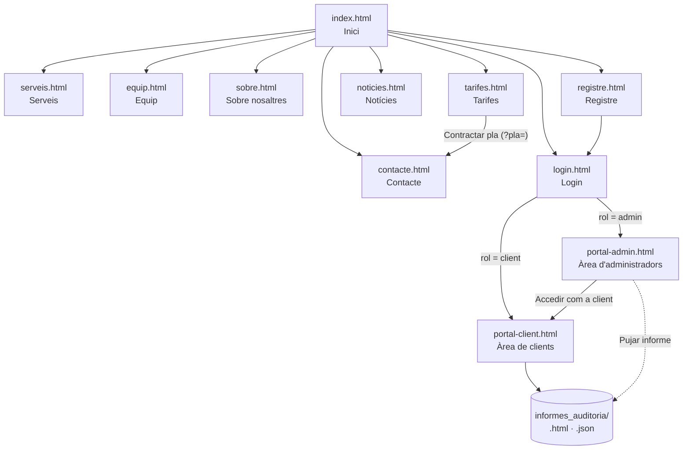

# Documentació de la Landing Page · Zevix Cybersecurity

**Projecte Intermodular (MP0379) · CFGS ASIX Ciberseguretat · Institut de l'Ebre · Curs 2026-27**
**Grup 3:** Pau Serra Bertomeu · Iker Espinosa López · Maria del Valle Suñe Nieto
**Sprint 1**. Lliurament màxim: 30/11/2026

---

## Índex

1. [Descripció](#1-descripció)
2. [Tecnologies utilitzades](#2-tecnologies-utilitzades)
3. [Sitemap](#3-sitemap)
4. [Mockup](#4-mockup)
5. [Descripció dels fitxers principals](#5-descripció-dels-fitxers-principals)
6. [Explicació de les principals decisions preses](#6-explicació-de-les-principals-decisions-preses)
7. [Desplegament](#7-desplegament)
8. [Transició cap a la plataforma](#8-transició-cap-a-la-plataforma)
9. [Ús d'intel·ligència artificial](#9-ús-dintel·ligència-artificial)

---

## 1. Descripció

La landing page és la carta de presentació de **Zevix Cybersecurity**, l'empresa d'auditories de seguretat informàtica creada pel Grup 3. Té dos objectius:

- **Comercial:** captar l'interès de possibles clients (pimes), explicar els serveis, mostrar l'equip, els plans de preus i facilitar el contacte.
- **Funcional:** ser la porta d'entrada a la **plataforma** on els clients consulten i descarreguen els informes d'auditoria i on l'equip Zevix gestiona clients i informes.

Flux d'usuari: **Usuari → Landing Page → Login → Plataforma (Àrea de clients / Àrea d'administradors) → Resultats de l'auditoria.**

Pàgines que inclou:

| Pàgina | Contingut |
|---|---|
| Inici | Navbar (logo, menú, botons *Accedir* i *Registrar-se*) i un **recorregut 3D (Scroll World)** que ocupa tota la portada: presentació amb la proposta de valor, les 4 fases de l'auditoria (que expliquen els serveis) i crida a l'acció final. Acaba amb el footer (logos de clients, xarxes socials i butlletí) |
| Serveis | Fitxa de cada mòdul de l'eina (OSINT amb Shodan i theHarvester, Nmap, Nikto, DNS/Whois, SSH/SMB en desenvolupament i pla de millora) amb el seu estat, **captures reals de la versió 2 de l'eina** (tkinter) executant Nmap i dig, el menú de Shodan, i la nostra **anàlisi de riscos** del cas EbreLogistics (model INCIBE) |
| Equip | Membres, càrrec, estudis, descripció i gustos, amb fotografia |
| Sobre nosaltres | Història, finalitat de l'empresa, missió/visió/valors i estàndards |
| Tarifes | 3 plans (**Bàsic**, **Professional** i **Avançat**, és a dir senzill, mitjà i fort), comparativa i FAQ |
| Notícies | Blog d'articles de ciberseguretat amb filtre per categories |
| Contacte | Formulari amb validació, dades de contacte, xarxes socials i mapa |
| Login / Registre | Accés per rols (client / administrador) i alta de nous clients |
| Portal client | Resum de riscos, llistat de vulnerabilitats, pla de millora i **descàrrega d'informes** |
| Portal admin | Gestió de clients, estat dels mòduls de l'eina, pujada d'informes, registre d'activitat i opció d'**accedir com a client** |

## 2. Tecnologies utilitzades

| Tecnologia | Ús al projecte |
|---|---|
| **HTML5** | Estructura semàntica (`header`, `nav`, `main`, `section`, `article`, `footer`), formularis amb atributs d'accessibilitat |
| **CSS3** | Disseny responsive amb **CSS Grid** i **Flexbox**, variables CSS (`:root`) per als colors corporatius, animacions i *media queries* (mòbil, tauleta, escriptori) |
| **JavaScript (ES6)** | Manipulació del DOM, validació de formularis, menú mòbil, animacions en fer scroll (`IntersectionObserver`), lectura de l'informe JSON amb `fetch()` i mòdul d'autenticació per rols |
| **Three.js (r128, WebGL)** | Efecte *Scroll World* de la portada: món 3D on el scroll controla la càmera (carregat des de cdnjs) |
| **SVG** | Icones vectorials |
| **Google Fonts** | Tipografies *Inter* (text) i *JetBrains Mono* (detalls tècnics) |
| **Git + GitHub** | Control de versions i treball col·laboratiu |
| **GitHub Pages** | Allotjament i desplegament amb HTTPS |
| **Python (script de generació)** | No es publica; les pàgines comparteixen capçalera i peu i s'han mantingut coherents |

L'única llibreria externa és Three.js, i només a la portada. La resta és JavaScript propi, sense frameworks: la web és lleugera, ràpida i fàcil d'auditar.

## 3. Sitemap



Nivells:

- **Nivell 1, zona pública:** Inici, Serveis, Equip, Sobre, Tarifes, Notícies, Contacte.
- **Nivell 2, passarel·la d'autenticació:** Login i Registre.
- **Nivell 3, zona privada:** Portal de clients i Portal d'administradors (protegits per rol).

## 4. Mockup

Abans de programar es va fer el següent esquema (wireframe) de la pàgina d'inici i del login. Paleta: negre neutre `#0b0c0d`, accent ambre `#f5a524` i colors de gravetat CVSS (vegeu 6.1).

La portada és una sola pantalla fixa (el món 3D) on el contingut canvia a mesura que es fa scroll. Cada requadre és un "fotograma" del recorregut:

```
NAVBAR (sempre visible)
┌──────────────────────────────────────────────────────────────────────┐
│ [ZVX] ZEVIX▮   Inici Serveis Equip Sobre Tarifes Notícies Contacte  [Accedir][Registrar-se] │
└──────────────────────────────────────────────────────────────────────┘

0 %  ·  INTRO: portada del document sobre el món 3D
┌──────────────────────────────────────────────────────────────────────┐
│      DOC ZVX-WEB-001 · CLASSIFICACIÓ: PÚBLIC · REV. 4 · [hora real]  │
│ ┌──────────────────────────────────────────┐                         │
│ │ INFORME D'AUDITORIA DE SEGURETAT          │               01 OSINT ─ │
│ │ Trobem les vulnerabilitats de la teva     │               02 XARXA ─ │
│ │ empresa abans que ho faci un atacant.     │               03 CPD   ─ │
│ │ CLIENT   ████████  (es descobreix)        │          04 PROTECCIÓ ─ │
│ │ ABAST    Xarxa, servidors i serveis       │                         │
│ │ MÈTODE   OSINT → escaneig → anàlisi → pla │                         │
│ │ [SOL·LICITAR AUDITORIA] [VEURE SERVEIS]   │                         │
│ └──────────────────────────────────────────┘                         │
│▔▔▔▔▔▔▔▔▔▔▔▔▔▔▔▔▔▔▔▔▔▔▔▔▔▔ barra de progrés ▔▔▔▔▔▔▔▔▔▔▔▔▔▔▔▔▔▔▔▔▔▔▔▔▔▔│
└──────────────────────────────────────────────────────────────────────┘

7–27 %  ·  FASE 01: la càmera envolta el globus
┌──────────────────────────────────────────────────────────────────────┐
│                     (globus 3D amb satèl·lits)              01 OSINT ━ │
│ ┌─────────────────────────────────────┐                     02 XARXA ─ │
│ │ ZVX-F01   FASE 01 / 04   [EXTERIOR] │                     03 CPD   ─ │
│ │ Reconeixement OSINT                 │                04 PROTECCIÓ ─ │
│ │ EINES     shodan · theharvester     │                                │
│ └─────────────────────────────────────┘                                │
└──────────────────────────────────────────────────────────────────────┘

27–53 %  FASE 02: sobrevola la ciutat de servidors     (mateixa estructura)
53–76 %  FASE 03: entra al passadís de racks del CPD   (mateixa estructura)
76–93 %  FASE 04: arriba a la cúpula-escut             (mateixa estructura)

93–100 %  ·  FINAL: la càmera s'allunya
┌──────────────────────────────────────────────────────────────────────┐
│                        [ AUDITAT ✓ ]  (segell)                        │
│        Saps quantes portes té obertes la teva xarxa?                  │
│         [Veure tarifes]  [Crear compte de client]                     │
└──────────────────────────────────────────────────────────────────────┘

FOOTER
┌──────────────────────────────────────────────────────────────────────┐
│  Empreses que confien: EbreLogistics · DeltaAgro · Clínica Montsià…  │
│  logo + xarxes socials | Empresa | Serveis | Butlletí                 │
└──────────────────────────────────────────────────────────────────────┘

LOGIN
┌───────────────────────────┬──────────────────────────┐
│ Accés a la plataforma     │  Iniciar sessió          │
│ ◆ Resum de riscos         │  [ Client | Administrador ]│
│ ◆ Descàrrega d'informes   │  Correu    [__________]  │
│ ◆ Pla de millora          │  Contrasenya [________]  │
│                           │  [        Entrar       ] │
└───────────────────────────┴──────────────────────────┘
```

> Es pot substituir aquest esquema per una captura del mockup fet amb Figma / Penpot si l'equip el prepara (desar-lo a `docs/img/mockup.png`).

## 5. Descripció dels fitxers principals

```
PROJECTE-INTERMODULAR/
├── index.html               Pàgina d'inici (landing)
├── index-original.html      Còpia de seguretat de la portada amb el disseny anterior
├── serveis.html             Detall dels serveis
├── equip.html               Presentació de l'equip
├── sobre.html               Història i valors de l'empresa
├── tarifes.html             Plans Bàsic / Professional / Avançat
├── noticies.html            Blog de ciberseguretat
├── contacte.html            Formulari de contacte
├── login.html               Inici de sessió per rols
├── registre.html            Alta de nous clients
├── portal-client.html       Àrea privada de clients
├── portal-admin.html        Àrea privada d'administradors
├── assets/
│   ├── css/style.css        Full d'estils (variables, components, estil informe, responsive)
│   ├── css/style-original.css  Còpia del disseny anterior (només per a index-original.html)
│   ├── js/main.js           Lògica comuna: menú, animacions, formularis, tarifes, blog
│   ├── js/auth.js           Mòdul d'autenticació i control d'accés per rols (prototip)
│   ├── js/scroll-world.js   Efecte Scroll World: món 3D amb Three.js controlat pel scroll
│   └── img/                 Logo, favicon i fotos de l'equip (img/equip/*.jpg)
├── auditoria/               Eina d'auditoria en Python v2 (zevix_audit.py, shodan_audit.py)
├── informes_auditoria/      Informes d'exemple que genera l'eina Python (.json / .html)
├── docs/                    Documentació del projecte
├── .nojekyll                Indica a GitHub Pages que serveixi els fitxers tal qual
└── README.md                Portada del repositori
```

| Fitxer | Responsabilitat |
|---|---|
| `assets/css/style.css` | Tot el disseny. Els colors es defineixen com a variables a `:root`, de manera que canviar la imatge corporativa només requereix editar unes línies. |
| `assets/js/main.js` | Comportament de la web pública: menú hamburguesa, animacions `reveal` en fer scroll, commutador mensual/anual de tarifes, filtre del blog i validació del formulari de contacte (`validateForm`). |
| `assets/js/auth.js` | Objecte `ZevixAuth` amb `login()`, `register()`, `logout()`, `currentUser()` i `require(roles)`. Guarda la sessió a `sessionStorage` i protegeix les pàgines privades redirigint al login si no hi ha sessió o el rol no és vàlid. |
| `assets/js/scroll-world.js` | Crea l'escena 3D (globus OSINT, ciutat de servidors, passadís del CPD i cúpula-escut), calcula el progrés del scroll dins la secció `#world` (0 → 1) i mou la càmera seguint uns fotogrames clau (`KEYS`). Mostra el text de cada etapa segons els atributs `data-from` / `data-to` de l'HTML, actualitza la barra i els punts de progrés i només renderitza quan la secció és visible. |
| `portal-client.html` | Llegeix `informes_auditoria/informe_ebrelogistics_2026.json` amb `fetch()` i genera dinàmicament els comptadors per gravetat, la barra de risc, la taula de vulnerabilitats i el pla de millora. Permet descarregar l'informe en HTML i JSON. |
| `portal-admin.html` | Només accessible amb rol `admin`. Llista de clients, estat dels mòduls de l'eina, formulari de pujada d'informes (simulat) i registre d'activitat. |
| `informes_auditoria/*.json` | Format d'informe que exportarà l'eina d'auditoria en Python. És el "contracte" de dades entre l'eina i la plataforma web. |

## 6. Explicació de les principals decisions preses

### 6.1 Disseny: estil "informe d'auditoria"
La primera versió feia servir una estètica molt habitual (fons fosc, degradats cian/blau, targetes de vidre arrodonides i icones en caixes) que semblava una plantilla genèrica. Per diferenciar-nos, la web adopta el **llenguatge visual del nostre propi producte: un expedient de pentesting**.

| Element | Decisió | Per què |
|---|---|---|
| Tipografia | **IBM Plex Mono** (títols, etiquetes) + **IBM Plex Sans** (text) | Aspecte de documentació tècnica, no d'anunci |
| Color | Negre neutre `#0b0c0d`, un sol accent ambre `#f5a524` i els **colors de gravetat CVSS** (crítica, alta, mitjana, baixa) | El color té significat; s'eliminen els degradats decoratius |
| Formes | Cantonades rectes (2–3 px), línies d'1 px, sense ombres ni vidre | Sobri i professional, com un document |
| Logo | Wordmark `[ZVX] ZEVIX▮` amb cursor parpellejant | Més propi que un escut genèric |
| Capçaleres | Franja de document a cada pàgina: `DOC ZVX-WEB-00X · CLASSIFICACIÓ · REV.` | Cada pàgina és un "document" de l'expedient |
| Contingut | **Fitxes** amb referència (`ZVX-SRV-01`, `ZVX-EQ-02`), taules de camps i llistes numerades en lloc de graelles de targetes | Lectura més clara i coherent amb un informe |
| Detalls | Text **censurat** (`████`) que es descobreix en passar-hi el ratolí, segell **AUDITAT ✓** al final de la portada i peu de pàgina com una línia de log amb l'hora real | Reforcen la idea de confidencialitat i auditoria |
| Món 3D | Línies de plànol en blanc trencat; només els riscos en vermell i la protecció en verd | Mateixa paleta que la resta de la web |

**Còpia de seguretat del disseny anterior:** l'etiqueta de git `disseny-original` guarda el projecte complet abans del canvi, i la portada antiga es pot veure a `index-original.html` (amb el seu full d'estils `assets/css/style-original.css`).

- **Portada com a recorregut 3D:** en lloc d'una portada amb molts blocs de text, el visitant "viatja" per les fases de l'auditoria. Així s'explica el servei de manera visual i memorable amb molt poc text.
- **Mobile-first i responsive:** tota la web s'adapta a mòbil, tauleta i escriptori.
- **Accessibilitat:** etiquetes `label` als formularis, `aria-label` a les icones, contrast alt i respecte a `prefers-reduced-motion`.
- **Plans de preus en 3 nivells** (senzill, mitjà, fort), tal com indica l'enunciat, amb el pla mitjà destacat com a "més popular".

### 6.2 Efecte Scroll World
Tota la portada és un recorregut 3D: en fer scroll, una càmera vola **sense talls** per un petit món i entra a cada escena. Cada escena és una fase del servei:

| Scroll | Etapa | Escena 3D | Missatge |
|---|---|---|---|
| 0–7 % | Intro | Vista general de tot el món | Proposta de valor i botons d'acció |
| 7–27 % | 01 · Internet | Globus amb satèl·lits i punts de serveis exposats | Reconeixement OSINT (Shodan, theHarvester) |
| 27–53 % | 02 · La xarxa | Ciutat de servidors connectats, paquets de dades i anell d'escaneig | Descobriment d'hosts i ports (Nmap) |
| 53–76 % | 03 · El CPD | Passadís de racks amb LEDs, alertes vermelles i pla d'escaneig | Anàlisi de vulnerabilitats (SSH, SMB...) |
| 76–93 % | 04 · Protecció | Cúpula-escut verda amb un check | Informe i pla de millora |
| 93–100 % | Final | La càmera s'allunya | Crida a l'acció: tarifes i registre |

**Com funciona:**
1. La secció `#world` fa **750vh** d'alt i dins hi ha un contenidor `position: sticky` d'una pantalla amb el `canvas`. Mentre es baixa, el canvas es queda fix i només canvia el que es veu.
2. El JavaScript calcula el **progrés** (0 → 1) segons quanta part de la secció s'ha recorregut. Es suavitza a cada fotograma perquè el moviment sigui fluid.
3. La càmera segueix una llista de **fotogrames clau** (`KEYS`): cada un indica en quin percentatge de scroll la càmera ha d'estar en una posició i mirant a un punt. Entre fotogrames la posició s'interpola amb una corba `CatmullRomCurve3` i un suavitzat *smoothstep*. Així cada fase té el seu tram i el text sempre coincideix amb l'escena.
4. Els textos (`.world-stage`) tenen `data-from` i `data-to` a l'HTML i el JS els mostra quan el progrés és dins del seu rang. També s'actualitzen la **barra de progrés** i els **punts** de la dreta, que es poden clicar per saltar a una fase.
5. Per estalviar bateria, només es renderitza quan la secció és visible (`IntersectionObserver`). En mòbil es redueixen les partícules i s'obre el camp de visió.

**Decisió:** la tècnica s'inspira en el projecte [scroll-world](https://github.com/oso95/scroll-world), però aquesta genera els vols amb vídeos pre-renderitzats en serveis de pagament (Monid/Higgsfield). Nosaltres renderitzem l'escena en temps real amb WebGL: és gratuït, ocupa uns pocs KB i funciona a GitHub Pages. Si el navegador no té WebGL, tot el contingut es mostra com a seccions estàtiques.

**Problema trobat i solució (memòria cau):** en publicar la nova versió, alguns navegadors continuaven fent servir el CSS antic i el text de les fases sortia sense estil. Per evitar-ho, els fitxers s'enllacen amb un número de versió (ara `?v=8`). Cada vegada que es modifiquin cal augmentar aquest número a tots els HTML.

### 6.3 Justificació de tecnologies

| Opció | Avantatges | Inconvenients | Decisió |
|---|---|---|---|
| **HTML + CSS + JS estàtic** | Gratuït a GitHub Pages, HTTPS automàtic, molt ràpid, superfície d'atac mínima (no hi ha servidor ni base de dades exposats) | No pot validar credencials ni guardar dades de forma segura | ✅ **Fase 1 (Sprint 1)**: web pública i prototip de la plataforma |
| **Arquitectura LAMP** (Linux, Apache, MySQL, PHP) | Coneguda a ASIX, fàcil de desplegar en una VM/LXC de Proxmox o a AWS | En PHP pur cal programar a mà la seguretat (SQLi, XSS, sessions) | Alternativa per a la fase 2 |
| **Laravel** (PHP) | Autenticació i rols integrats, protecció CSRF, ORM | Llenguatge diferent del de l'eina d'auditoria (Python) | Descartat |
| **Django** (Python) | Mateix llenguatge que l'eina d'auditoria: pot llegir directament els informes JSON; autenticació, panell d'admin i protecció CSRF/XSS integrats | Necessita un servidor (no funciona a GitHub Pages) | ✅ **Fase 2 (Sprint 2-3)**: plataforma real |

**Arquitectura evolutiva en dues fases:**

1. **Fase 1 (actual):** web estàtica a GitHub Pages. El login és un **prototip** en JavaScript que demostra el flux complet per rols. ⚠️ No és segur (les credencials de demostració són al codi i la comprovació es fa al navegador); només serveix per a la demostració del Sprint 1.
2. **Fase 2:** la plataforma passa a **Django** desplegat en un servidor propi (Proxmox / LAMP) o a AWS, amb contrasenyes amb hash, sessions al servidor, protecció CSRF i informes guardats fora de l'abast públic. La landing page pot continuar a GitHub Pages.

### 6.4 Altres decisions
- **Informes en JSON:** l'eina Python exportarà els resultats en JSON; la web només ha de llegir aquest fitxer, cosa que desacobla l'eina de la plataforma.
- **Sense dependències externes de JavaScript:** menys risc de seguretat a la cadena de subministrament i més fàcil de justificar el codi.
- **Empreses i dades fictícies:** EbreLogistics S.L. és l'empresa auditada del nostre contracte simbòlic; la resta de logos de clients i les dades de l'informe són d'exemple.

## 7. Desplegament

### 7.1 GitHub Pages
1. Pujar el codi a la branca `main` del repositori `pauserra-IE/PROJECTE-INTERMODULAR`.
2. A GitHub: **Settings → Pages → Build and deployment → Source: Deploy from a branch**.
3. Seleccionar la branca `main` i la carpeta `/ (root)` i desar.
4. En uns minuts la web està disponible a: **https://pauserra-ie.github.io/PROJECTE-INTERMODULAR/**
5. El fitxer `.nojekyll` evita que GitHub processi els fitxers amb Jekyll.

### 7.2 Domini personalitzat gratuït (1 any) amb el GitHub Student Developer Pack
1. Sol·licitar el pack a <https://education.github.com/pack> amb el correu de l'institut.
2. Registrar el domini gratuït (el grup ha triat `zevixcyber.tech`, amb get.tech) i **desactivar la renovació automàtica**.
3. Al panell DNS del registrador crear:
   - 4 registres **A** per a `@` → `185.199.108.153`, `185.199.109.153`, `185.199.110.153`, `185.199.111.153`
   - 1 registre **CNAME** per a `www` → `pauserra-ie.github.io`
4. A **Settings → Pages → Custom domain** escriure el domini i desar (es crea un fitxer `CNAME`).
5. Quan propagui el DNS, marcar **Enforce HTTPS** (certificat Let's Encrypt automàtic).

### 7.3 Prova en local
```bash
cd PROJECTE-INTERMODULAR
python3 -m http.server 8000
# obrir http://localhost:8000
```
(Cal un servidor perquè el portal de clients pugui carregar l'informe JSON amb `fetch()`.)

## 8. Transició cap a la plataforma

| Funcionalitat | Sprint 1 (prototip) | Fase 2 (Django / LAMP) |
|---|---|---|
| Login | `auth.js` al navegador, `sessionStorage` | Validació al servidor, contrasenyes amb hash, sessions i CSRF |
| Rols | `client` / `admin` comprovats a `ZevixAuth.require()` | Grups i permisos de Django (middleware) |
| Registre | `localStorage` del navegador | Base de dades (MySQL/MariaDB o PostgreSQL) |
| Informes | Fitxers d'exemple a `informes_auditoria/` | Directori protegit `REPORTS_DIR` + base de dades, cada client només veu els seus |
| Pujada d'informes | Simulada | Pujada real des del portal admin o automàtica des de l'eina Python / Docker |
| Notificacions | — | Bot de Telegram |

## 9. Ús d'intel·ligència artificial

Les indicacions del projecte permeten fer servir IA sempre que es justifiqui el codi i la seva funció. Aquest apartat explica quines eines hem fet servir, per a què, què ha decidit i revisat l'equip i com funcionen les parts principals del codi.

### 9.1 Eines i ús

| Eina | Per a què l'hem fet servir |
|---|---|
| **Gemini** (Google) | Planificació inicial del projecte: anàlisi de l'enunciat i del calendari de lliuraments, idees d'estructura del repositori i de la landing page, comparativa de tecnologies (estàtic, LAMP, Django, Laravel) i opcions de desplegament. |
| **Claude Code** (Anthropic) | Generació del codi de la web (HTML, CSS i JavaScript), de l'efecte 3D amb Three.js i d'aquesta documentació, a partir de les nostres indicacions. També la **versió 2 de l'eina d'auditoria** (`auditoria/`): nou disseny, Shodan integrat, validació de dades i exportació, a partir del codi de la nostra v1. Els commits on ha participat porten la línia `Co-Authored-By: Claude` a l'historial de Git. |

### 9.2 Què ha fet l'equip

- **Decisions de projecte:** nom i identitat de l'empresa (Zevix Cybersecurity), client auditat (EbreLogistics S.L.), rols Scrum, pàgines que havia de tenir la web segons l'enunciat i els tres plans de preus (senzill, mitjà i fort).
- **Contingut propi:** el contracte simbòlic, l'anàlisi de riscos (model INCIBE) i la **primera versió** de l'eina d'auditoria en Python (theHarvester, Shodan, Nmap, Nikto i utilitats de xarxa). Vam decidir quines millores calia fer a la v2, com treure la clau de Shodan del codi seguint la nostra pròpia anàlisi de riscos. La web reutilitza aquest material: la taula de riscos de Serveis, els mòduls i les captures de l'eina.
- **Direcció del disseny:** vam demanar l'efecte Scroll World, el vam fer refer quan el resultat no ens convencia i vam escollir l'estil "informe d'auditoria" entre diverses propostes. Abans del canvi d'estil vam guardar una còpia de seguretat (etiqueta `disseny-original`).
- **Revisió i proves:** comprovació de totes les pàgines, del login amb els dos rols, del portal de clients i de la versió mòbil, i correcció dels errors trobats (per exemple, la memòria cau del navegador, que mostrava el CSS antic).
- **Desplegament:** pujada al repositori amb Git i activació de GitHub Pages.

### 9.3 Què cal tenir en compte

- Les dades que es veuen a la web són **d'exemple**: clients, telèfon, correu i informe de vulnerabilitats. Els interessos de l'equip són orientatius.
- El login és un **prototip** que funciona al navegador (vegeu 6.3). No és segur i se substituirà per un backend a la fase 2.
- La IA s'ha equivocat en alguns punts que vam haver de corregir, com els rols de l'equip o eines de l'auditoria que no fèiem servir. Per això tot el contingut s'ha contrastat amb els nostres documents.

### 9.4 Com funciona el codi (justificació)

**Login i rols (`assets/js/auth.js`).** Hi ha una llista d'usuaris de prova i una funció `login(email, contrasenya, rol)` que busca l'usuari i comprova que el rol coincideixi. Si és correcte, guarda la sessió a `sessionStorage` (s'esborra en tancar la pestanya) i redirigeix al portal que toca. Cada pàgina privada crida `ZevixAuth.require(["admin"])` o `require(["client", "admin"])` en carregar-se: si no hi ha sessió o el rol no és vàlid, torna al login. El registre afegeix usuaris a `localStorage`, només en aquell navegador.

**Portal de clients (`portal-client.html`).** Amb `fetch()` llegeix el fitxer `informes_auditoria/informe_ebrelogistics_2026.json`, que té el format que exportarà la nostra eina. A partir d'aquestes dades compta les vulnerabilitats per gravetat, dibuixa la barra de risc i omple les taules. Si l'eina genera un altre JSON amb el mateix format, el portal el mostra sense tocar el codi.

**Efecte Scroll World (`assets/js/scroll-world.js`).**
1. Es crea una escena de Three.js amb quatre grups d'objectes (globus, ciutat, passadís de racks i cúpula), situats un darrere l'altre a l'eix Z.
2. En cada moviment del scroll es calcula el progrés dins la secció: `progrés = scroll recorregut / (alçada de la secció - alçada de la finestra)`, un valor entre 0 i 1.
3. La llista `KEYS` defineix on ha de ser la càmera i cap a on ha de mirar en cada percentatge. La funció `curveT()` busca entre quins dos fotogrames clau som i calcula una posició intermèdia suavitzada sobre una corba `CatmullRomCurve3`.
4. Els textos de cada fase tenen `data-from` i `data-to` a l'HTML, i el JavaScript mostra el que correspon al progrés actual.
5. Només es dibuixa quan la secció és visible (`IntersectionObserver`), per no gastar bateria.

**Formularis (`assets/js/main.js`).** La funció `validateForm()` recorre els camps obligatoris, comprova que no estiguin buits, que el correu tingui un format vàlid i la longitud mínima, i marca en vermell els camps incorrectes. Com que la web és estàtica, l'enviament es simula.

**Eina d'auditoria (`auditoria/zevix_audit.py`).** L'explicació pas a pas (validació, fil secundari, cua de missatges, exportació) i la taula de canvis respecte a la v1 són a [auditoria/README.md](../auditoria/README.md).

**Estils (`assets/css/style.css`).** Els colors, les tipografies i les mides es defineixen com a variables a `:root`, de manera que canviar l'aspecte de tota la web només requereix editar unes línies. Els fitxers s'enllacen amb `?v=8` perquè els navegadors no facin servir una versió antiga desada a la memòria cau.

